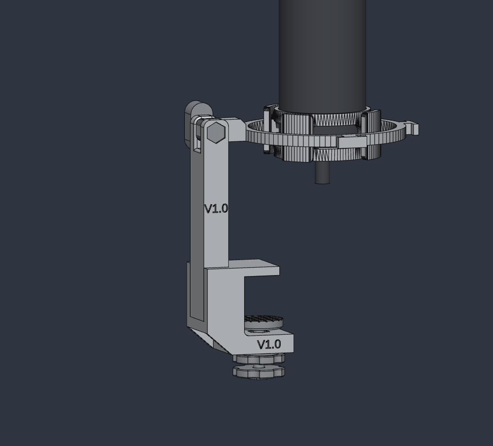
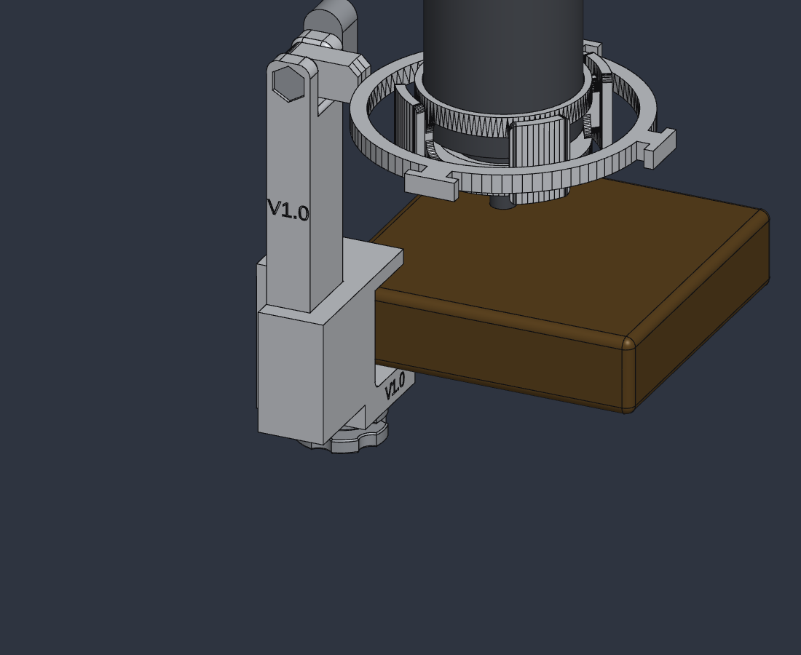

# FIFINE K669B — съёмное крепление на стол

Проект в SolidCraft: микрофон с виброподвесом закреплён на магнитной стойке, которую можно переносить между передним и правым краем стола. Основания зажимаются на столешнице 25 мм. При переносе ориентация микрофона сохраняется.

## Быстрый старт

- **Покупки:** [BOM с ссылками Unimagnet/Hornbach и выбором эластичного подвеса](BOM.md).

- **Для печати:** откройте [`print/`](print/) — все 10 STL и [список деталей, материалов и количества](print/README.md).
- **Переднее крепление:** [`cad/Fifine_Clamp_V1.sc`](cad/Fifine_Clamp_V1.sc).
- **Правое крепление:** [`cad/Fifine_Clamp_Right_V1.sc`](cad/Fifine_Clamp_Right_V1.sc).

Скачивайте весь репозиторий: сборки используют относительные ссылки на компоненты.

## Структура

```text
cad/                  актуальные сборки и связанные компоненты
  archive/            предыдущие версии и сохранённый черновик
print/
  petg/               жёсткие детали и исходные детали виброподвеса
  tpu/                мягкая пятка и верхняя накладка
  README.md           комплект для печати и покупной крепёж
docs/
  clamp-V1.png        передняя версия
  clamp-right-V1.png  правая версия
  history/            изображения предыдущих версий
```

Локальные резервные копии сохранены в `.local/backups/` и не публикуются в Git.

## CAD

| Файл в `cad/` | Назначение |
|---|---|
| `Fifine_Clamp_V1.sc` | Передняя сборка со стойкой, подвесом и микрофоном |
| `Fifine_Clamp_Right_V1.sc` | Правая сборка с той же ориентацией стойки |
| `table_clamp_V1.sc` | Переднее основание, ручки, пятки и крепёж |
| `table_clamp_right_V1.sc` | Правое основание с повёрнутым приёмником и одним раскосом |
| `knob.sc`, `nut.sc` | Связанные компоненты шарнира подвеса |
| `magnet.sc`, `mic_primitive.sc` | Модели магнита и микрофона для компоновки |

Не разносите файлы внутри `cad/`: ссылки сохранены без изменения CAD-контейнеров. Архив содержит копии общих компонентов и открывается независимо от актуальной версии.

## Конструкция V1.0

Стальной винт М6×25, обычная гайка М6 в основании, тонкая контргайка ISO 4035 в отдельном вентиле, увеличенная стальная шайба 6,4×18×1,6 мм. Обе ручки имеют выемки под пальцы; PETG-основа нижней пятки закрыта съёмным TPU-колпачком. Под верхней полкой предусмотрена TPU-накладка. Стойка и основания маркированы V1.0.

В правой версии магнитная площадка повёрнута на 90°, её наружный торец и опора выровнены с торцом струбцины; по Y основание занимает 0…35 мм в исходных координатах. Под выносом один раскос толщиной 6 мм. Выступ 0,3 мм у входа в направляющую снят.





## Проверки

В SolidCraft проверены ошибки операций и соединений, отсутствие непредусмотренных пересечений, посадка стойки и компоновка с 25-миллиметровой столешницей. Координаты и нормали STL стойки в передней и правой сборках совпадают. Натяг TPU-колпачка на пятку предусмотрен намеренно. Проверки геометрии не заменяют испытания печатного прототипа на прочность и удобство.

При организации файлов содержимое CAD и STL сохранено побайтово. Проверены ZIP-контейнеры `.sc` и доступность всех относительных ссылок; актуальные сборки открыты через MCP из новой папки.

## Исходный виброподвес

Два файла `Fifine_Condenser_Shock_Mount_*.stl` — исходные детали стороннего подвеса. Связанная модель: [Fifine Condenser — K669B Shock Mount, MikeTitor](https://www.thingiverse.com/thing:4659142). Условия использования проверяйте на странице автора; этот репозиторий не устанавливает для неё новую лицензию.

## Git

Перед коммитом сохраняйте проект в SolidCraft. Перед переключением версий закрывайте проект и открывайте заново. `.sc` хранится как целый CAD-документ; резервные копии и файлы блокировки исключены через `.gitignore`.
