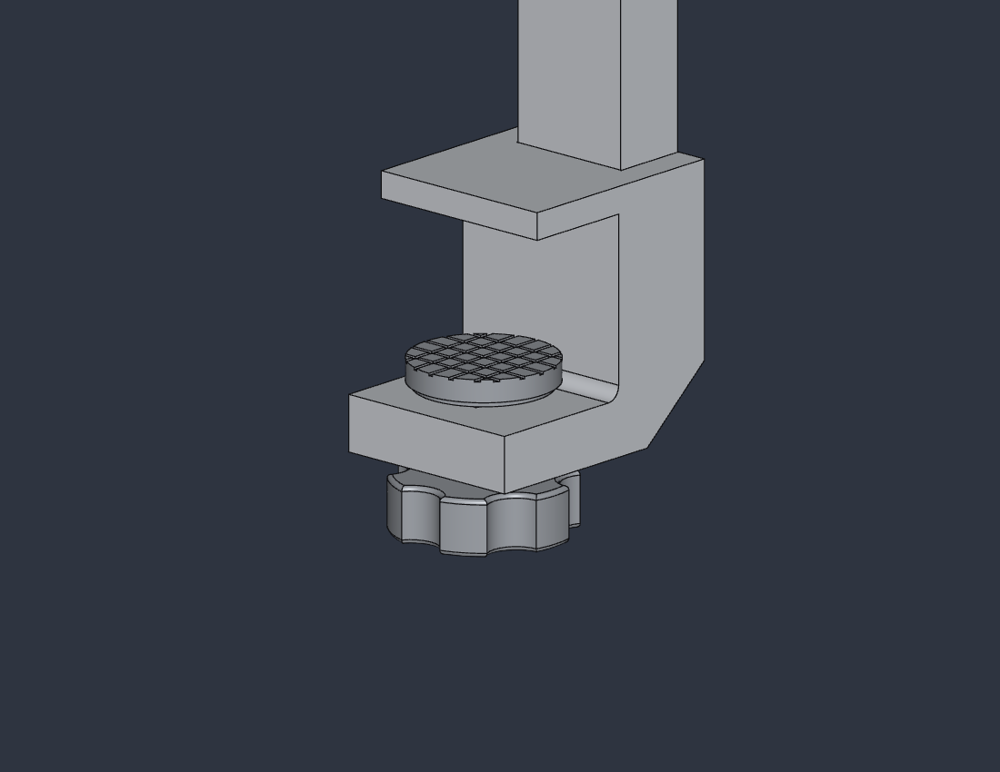

# FIFINE K669B — магнитное крепление со струбциной М6

Съёмное настольное крепление в SolidCraft. Магнитная стойка с виброподвесом переставляется между основаниями; основание зажимается на столешнице винтом.

## Актуальная версия v2

Открывайте **`Fifine_Clamp_M6_v2.sc`** — общую сборку — или **`table_clamp_m6_v2.sc`** для редактирования основания, ручки и пятки. Все CAD-файлы оставляйте рядом: ссылки на компоненты относительные.

Изменения v2: болт М6×20 вместо М6×35, ручка с шестью выемками под пальцы и скруглениями R0,8, печатный TPU-колпачок с рельефом, два наружных раскоса между нижней полкой и бортиком магнитной направляющей.

## Детали для печати

| STL | Материал | Деталь |
|---|---|---|
| `clamp_base_m6.stl` | PETG | Основание: ширина 35 мм, проём 32,2 мм, нижняя полка 10 мм |
| `hand_knob_m6.stl` | PETG | Шестилепестковая ручка около Ø32 × 10 мм |
| `pressure_pad_24mm.stl` | PETG | Жёсткая пятка Ø24 × 3 мм с углублением под конец винта |
| `tpu_grip_pad.stl` | Forward AM Ultrafuse TPU 95A Black | Съёмный колпачок Ø26 мм: верх 2 мм, бортик 2 мм |

У колпачка канавки шириной 0,8 мм, глубиной 0,4 мм, с шагом 4 мм. Внутренний диаметр бортика 23,6 мм под пятку Ø24 мм: предусмотрен натяг 0,2 мм на сторону. Проверьте посадку на первой печати, при необходимости подстройте компенсацию размеров в слайсере. Колпачок надевается на пятку, совместная печать PETG и TPU не требуется.

Основание рекомендуется печатать на боковой поверхности: С-образный профиль лежит в плоскости слоёв. Стартовые настройки PETG: слой 0,2 мм, 5–6 периметров, 40–50% заполнения; поддержки в карманах проверьте в слайсере. Ручку печатайте карманом головки вверх, пятку — углублением вверх, TPU-колпачок — наружной рельефной поверхностью на столе, открытым бортиком вверх. Для TPU используйте профиль имеющегося принтера и материала, сплошное заполнение. STL находятся в координатах сборки: перед печатью разложите их на столе слайсера.

## Крепёж и сборка

- Один полностью резьбовой стальной болт **М6×20** с шестигранной головкой под ключ 10 мм.
- Одна обычная гайка **М6**, под ключ 10 мм, высотой около 5 мм.
- Четыре неодимовых магнита 25 × 8 × 5 мм, N52 — две пары.

1. Установите гайку сверху нижней полки в карман 10,4 мм между гранями, глубиной 5,4 мм. Под гайкой остаётся 4,6 мм пластика.
2. Вставьте болт в ручку снизу, головкой в шестигранный карман. При необходимости закрепите головку небольшим количеством клея.
3. Вкрутите болт снизу в гайку. Ось винта расположена в 14 мм от края столешницы.
4. Наденьте TPU-колпачок на PETG-пятку и положите пятку углублением на конец винта. Пятка свободная, без шарового шарнира: придерживайте её при снятии.
5. Наденьте основание на стол **25 мм** и затяните рукой до исчезновения люфта. В расчётном положении между верхом ручки и низом нижней полки около 3 мм.

Мягкая накладка называется `TPU_grip_pad`, жёсткая основа — `Pressure_pad`. Это две детали одной пятки, а не дубли. Стальные детали `M6x20_bolt_reference` и `M6_nut_reference` показаны для компоновки, печатать их не нужно. Резьба в CAD не моделируется.

[Выбранные магниты Unimagnet](https://www.unimagnet.cz/neodymovy-magnet-kvadr-25-8-5-mm-n52-sila-7-4-kg_z972/).

## Проверки и статус

Проверено через SolidCraft MCP: замкнутость тел, объёмы деталей, отсутствие ошибок операций и соединений, расположение крепежа и отсутствие непредусмотренных пересечений. Единственное предусмотренное пересечение — натяг TPU-бортика на PETG-пятку (около 29,91 мм³). Каждый раскос добавляет 252 мм³ пластика; суммарно 504 мм³. Раскосы не пересекают съёмную стойку.

Это прототип: проверки геометрии не заменяют испытание печатных деталей под нагрузкой. Посадки крепежа и колпачка следует проверить на первой печати.

## Предыдущие файлы и исходный подвес

`Fifine_Clamp_M6.sc` и `table_clamp_m6.sc` сохраняют предыдущий вариант. Актуальные STL относятся к v2. Первоначальная сборка — `Fifine_Condenser_Shock_Mount_2.sc`; исходные STL подвеса — `Fifine_Condenser_Shock_Mount_1.stl` и `Fifine_Condenser_Shock_Mount_2.stl`. Остальные `.sc` — связанные компоненты.

Связанная исходная модель: [Fifine Condenser — K669B Shock Mount, MikeTitor](https://www.thingiverse.com/thing:4659142). Условия использования сторонней модели проверяйте на странице автора; этот репозиторий не устанавливает для неё новую лицензию.

## Работа с Git

Перед коммитом сохраняйте проект в SolidCraft. Перед переключением версий закрывайте проект и открывайте заново. Резервные копии и файлы блокировки исключены через `.gitignore`.
