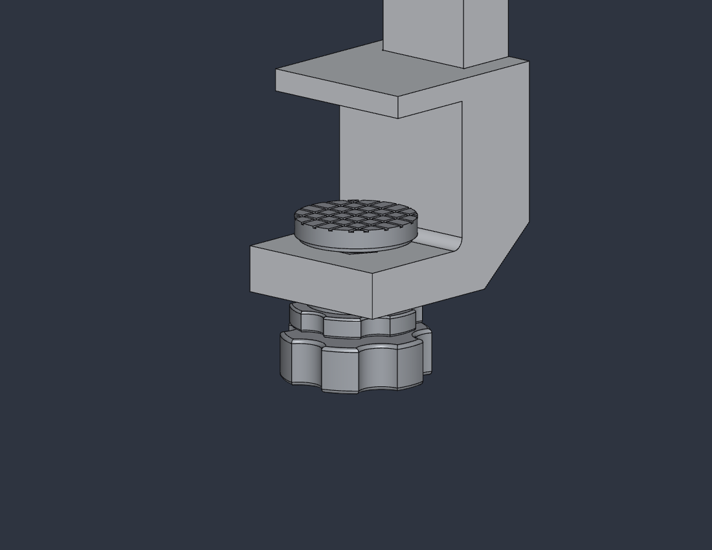

# FIFINE K669B — магнитное крепление со струбциной М6

Съёмное настольное крепление в SolidCraft. Магнитная стойка с виброподвесом переставляется между основаниями; основание зажимается на столешнице винтом.

## Актуальная версия v4

Открывайте **`Fifine_Clamp_M6_v4.sc`** — общую сборку — или **`table_clamp_m6_v4.sc`** для редактирования основания, ручки и пятки. Все CAD-файлы оставляйте рядом: ссылки на компоненты относительные.

Версия v4: увеличенная стальная шайба М6 6,4×18×1,6 мм и свободный центрирующий бортик на вентиле контргайки. Сохранены болт М6×25 и отдельный вентиль контргайки. Сохранены шестилепестковая основная ручка, TPU-колпачок с рельефом и два наружных раскоса.

## Детали для печати

| STL | Материал | Деталь |
|---|---|---|
| `clamp_base_m6.stl` | PETG | Основание: ширина 35 мм, проём 32,2 мм, нижняя полка 10 мм |
| `hand_knob_m6.stl` | PETG | Основная ручка около Ø32 × 10 мм |
| `locknut_handwheel_m6.stl` | PETG | Вентиль контргайки около Ø28 мм с центрирующим бортиком |
| `pressure_pad_24mm.stl` | PETG | Жёсткая пятка Ø24 × 3 мм с углублением под конец винта |
| `tpu_grip_pad.stl` | Forward AM Ultrafuse TPU 95A Black | Съёмный колпачок Ø26 мм: верх 2 мм, бортик 2 мм |

У колпачка канавки шириной 0,8 мм, глубиной 0,4 мм, с шагом 4 мм. Внутренний диаметр бортика 23,6 мм под пятку Ø24 мм: предусмотрен натяг 0,2 мм на сторону. Проверьте посадку на первой печати, при необходимости подстройте компенсацию размеров в слайсере. Колпачок надевается на пятку, совместная печать PETG и TPU не требуется.

Основание рекомендуется печатать на боковой поверхности: С-образный профиль лежит в плоскости слоёв. Стартовые настройки PETG: слой 0,2 мм, 5–6 периметров, 40–50% заполнения; поддержки в карманах проверьте в слайсере. Ручку печатайте карманом головки вверх, пятку — углублением вверх, TPU-колпачок — наружной рельефной поверхностью на столе, открытым бортиком вверх. Для TPU используйте профиль имеющегося принтера и материала, сплошное заполнение. STL находятся в координатах сборки: перед печатью разложите их на столе слайсера.

## Крепёж и сборка

- Один полностью резьбовой стальной болт **М6×25** с шестигранной головкой под ключ 10 мм.
- Одна обычная гайка **М6**, под ключ 10 мм, высотой около 5 мм.
- Одна тонкая гайка **М6 ISO 4035**, высота **3,2 мм**, под ключ 10 мм.
- Одна стальная плоская шайба **6,4 × 18 × 1,6 мм**, увеличенная DIN 9021 / ISO 7093 (отверстие × наружный диаметр × толщина).
- Четыре неодимовых магнита 25 × 8 × 5 мм, N52 — две пары.

1. Установите обычную гайку в карман сверху нижней полки.
2. Вставьте болт М6×25 в основную ручку снизу; при необходимости закрепите головку небольшим количеством клея.
3. Вставьте тонкую гайку в меньший вентиль. Карман глубиной 2,8 мм удерживает гайку высотой 3,2 мм: металл выступает на 0,4 мм и прижимает шайбу, не нагружая верхнюю кромку пластиковой ручки. При необходимости зафиксируйте гайку в кармане каплей клея, не попадая на резьбу.
4. Навинтите вентиль с тонкой гайкой на болт, выступающей металлической стороной вверх, затем наденьте шайбу. Вкрутите болт снизу в обычную гайку основания.
5. Наденьте TPU-колпачок на пятку и положите пятку углублением на конец винта. Пятка свободная: придерживайте её при снятии.
6. Установите основание на столешницу 25 мм. Основной ручкой создайте прижим, затем, придерживая её, подведите контргайку с шайбой к нижней полке и слегка подтяните меньший вентиль рукой.
7. Перед снятием сначала отпустите контргайку, затем основной винт. В затянутом положении между ручками около 1,5 мм; большего усилия инструментом не требуется.

Тонкая гайка рассчитана по [таблице производителя Ganter для ISO 4035](https://www.ganternorm.com/en/products/3.2-Mounting-Positioning-Leveling-with-Retaining-Cables-Screws-Clamping-and-Supporting-Elements/Nuts/ISO-4035-Thin-Hex-Nuts-Stainless-Steel?artikelnr=4035-M6-035-NI). М6 обозначает резьбу, а не размер ключа; для выбранной гайки размер под ключ — 10 мм. Печатные ручки позволяют обходиться без ключа. Стальную шайбу следует купить: она распределяет нагрузку и не ползёт как печатная пластиковая под постоянным прижимом.

Увеличенная шайба выбрана по [таблице размеров DIN 9021 / ISO 7093](https://www.aspenfasteners.com/content/pdf/Metric_DIN_9021_spec.pdf). Номинальная площадь её плоской кольцевой поверхности примерно в 2,75 раза больше прежней шайбы Ø12 мм; это не расчёт распределения напряжений в пластике.

Бортик вентиля: внутренний Ø18,6 мм, наружный Ø21 мм, толщина стенки 1,2 мм. Шайба Ø18 мм имеет по 0,3 мм радиального зазора. Верх бортика на 0,8 мм ниже рабочей поверхности шайбы, края скруглены R0,2. Прижим проходит через металлические гайку и шайбу; бортик не должен опираться в нижнюю полку. Бортик центрирует шайбу, но не защёлкивает её: на снятом с болта и перевёрнутом вентиле шайба может выпасть. На установленном болте она удерживается самим болтом и соседними деталями. Свободная посадка уменьшает риск сломать бортик при небольшом перекосе; значительный перекос и прочность печати требуют проверки на прототипе.

Мягкая накладка называется `TPU_grip_pad`, жёсткая основа — `Pressure_pad`. Это две детали одной пятки, а не дубли. Стальные детали `M6x25_bolt_reference`, `M6_nut_reference`, `M6_thin_locknut_reference` и `M6_steel_washer_reference` показаны для компоновки, печатать их не нужно. Резьба в CAD не моделируется.

[Выбранные магниты Unimagnet](https://www.unimagnet.cz/neodymovy-magnet-kvadr-25-8-5-mm-n52-sila-7-4-kg_z972/).

## Проверки и статус

Проверено через SolidCraft MCP: замкнутость тел, объёмы деталей, отсутствие ошибок операций и соединений, расположение крепежа и отсутствие непредусмотренных пересечений. Единственное предусмотренное пересечение — натяг TPU-бортика на PETG-пятку (около 29,91 мм³). Каждый раскос добавляет 252 мм³ пластика; суммарно 504 мм³. Раскосы не пересекают съёмную стойку.

Это прототип: проверки геометрии не заменяют испытание печатных деталей под нагрузкой. Посадки крепежа и колпачка следует проверить на первой печати.

## Предыдущие файлы и исходный подвес

`Fifine_Clamp_M6.sc` и `table_clamp_m6.sc` сохраняют предыдущий вариант. Файлы с суффиксом `_v2.sc` сохраняют вариант без контргайки. Файлы с суффиксом `_v3.sc` сохраняют вариант с шайбой Ø12 мм. Актуальные STL относятся к v4. Первоначальная сборка — `Fifine_Condenser_Shock_Mount_2.sc`; исходные STL подвеса — `Fifine_Condenser_Shock_Mount_1.stl` и `Fifine_Condenser_Shock_Mount_2.stl`. Остальные `.sc` — связанные компоненты.

Связанная исходная модель: [Fifine Condenser — K669B Shock Mount, MikeTitor](https://www.thingiverse.com/thing:4659142). Условия использования сторонней модели проверяйте на странице автора; этот репозиторий не устанавливает для неё новую лицензию.

## Работа с Git

Перед коммитом сохраняйте проект в SolidCraft. Перед переключением версий закрывайте проект и открывайте заново. Резервные копии и файлы блокировки исключены через `.gitignore`.
