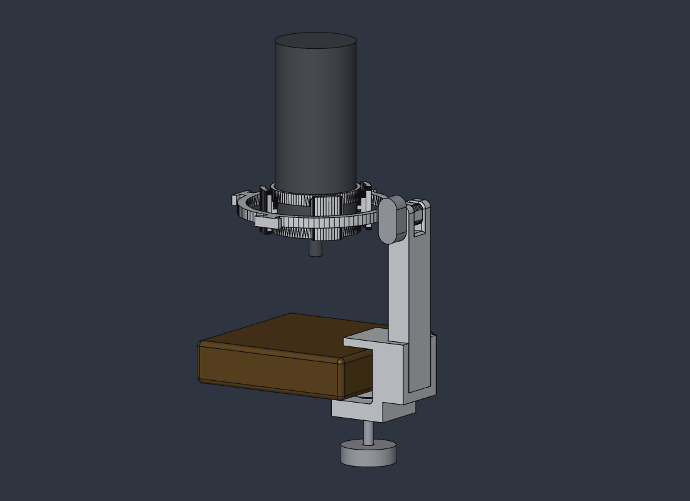

# FIFINE K669B — магнитное крепление на стол

Проект съёмного настольного крепления для микрофона FIFINE K669B в SolidCraft. Микрофон установлен в виброподвесе; стойка соединяется с основанием на краю стола с помощью магнитов. Предполагается возможность переносить стойку между передней и боковой позициями.

## Вариант со струбциной М6

Ветка `clamp-m6` содержит отдельный вариант без приклеивания основания к столу. Исходные CAD-файлы сохранены.

Открывайте **`Fifine_Clamp_M6.sc`** для общей сборки или **`table_clamp_m6.sc`** для редактирования струбцины и её деталей. Связанные файлы должны оставаться рядом.

### Детали для печати

| Файл | Деталь |
|---|---|
| `clamp_base_m6.stl` | Основание со струбциной и магнитными карманами |
| `hand_knob_m6.stl` | Ручка под шестигранную головку болта М6 |
| `pressure_pad_24mm.stl` | Свободная прижимная пятка Ø24 × 4 мм |

Размеры: ширина основания 35 мм, проём 32,2 мм, нижняя полка 10 мм, скругление её корня R2,5. Ось винта находится в 14 мм от торца столешницы. Отверстие под винт Ø6,6 мм; карман гайки 10,4 мм между гранями и 5,4 мм глубиной. Магнитные посадки и направляющие исходного основания сохранены.

### Покупные детали и сборка

- Один полностью резьбовой стальной болт **М6×35** с шестигранной головкой под ключ 10 мм.
- Одна обычная гайка **М6**, под ключ 10 мм, высотой около 5 мм.
- Круглая резиновая накладка Ø24 мм толщиной около 1 мм на пятку.
- Четыре ранее выбранных магнита для двух пар магнитного соединения.

1. Установите гайку в шестигранный карман сверху нижней полки. При затяжке гайка опирается на дно кармана; под ним остаётся 4,6 мм пластика.
2. Вставьте болт в ручку снизу, головкой в шестигранный карман. Головку можно закрепить небольшим количеством клея; ручка не содержит печатной резьбы.
3. Вкрутите болт снизу в гайку.
4. Положите пятку углублением Ø8 мм на конец винта, резиновой накладкой к столу. Пятка свободная, без защёлки и шарового шарнира; придерживайте её при установке и снятии.
5. Наденьте основание на столешницу и затяните рукой до исчезновения люфта. Расчётная компоновка показана для столешницы 25 мм.

Стальные болт, гайка и резиновая накладка представлены в CAD как упрощённые тела `*_reference`. Их не нужно печатать. Резьба в модели крепежа не моделируется.

### Печать и проверка

Основание рекомендуется печатать на боковой поверхности: С-образный профиль должен лежать в плоскости слоёв. Для первого прототипа: PETG, слой 0,2 мм, 5–6 периметров и 40–50% заполнения; необходимость поддержек в карманах проверьте в слайсере. Ручку можно печатать шестигранным карманом вверх, пятку — углублением вверх. STL экспортированы в координатах сборки: перед печатью разложите детали на столе слайсера.

Проверено через SolidCraft MCP: замкнутые тела, объёмы новых деталей, соосность отверстия и крепежа, отсутствие пересечений между основанием, стойкой, столешницей, пяткой, ручкой и крепежом, отсутствие ошибок операций и соединений после повторного открытия сборки. Две старые фаски основания в общей сборке отключены из-за изменившейся геометрии. Это геометрическая проверка, не испытание прочности. Посадки гайки и головки болта сначала проверьте короткой тестовой печатью.

## Исходные файлы

- `Fifine_Condenser_Shock_Mount_2.sc` — основная сборка.
- `table_mount.sc` — основание на краю столешницы.
- `knob.sc`, `nut.sc` — компоненты узла регулировки.
- `magnet.sc` — модель магнита.
- `mic_primitive.sc` — упрощённая модель микрофона для компоновки.
- `Fifine_Condenser_Shock_Mount_1.stl`, `Fifine_Condenser_Shock_Mount_2.stl` — исходные детали виброподвеса, не экспорт всей разработанной сборки.

## Открытие

Скачайте весь репозиторий и откройте `Fifine_Condenser_Shock_Mount_2.sc` в SolidCraft. Оставьте файлы компонентов рядом со сборкой: она использует относительные ссылки на них.

## Магниты

Планируется использовать четыре неодимовых магнита 25 × 8 × 5 мм, N52 — по два на каждой стороне соединения, то есть две пары.

[Выбранные магниты Unimagnet](https://www.unimagnet.cz/neodymovy-magnet-kvadr-25-8-5-mm-n52-sila-7-4-kg_z972/).

## Статус

Рабочий прототип. Пригодность к печати, посадки, прочность и удержание магнитами требуют проверки на изготовленных деталях. Предложенные в обсуждении изменения не следует считать реализованными: актуальная геометрия находится в CAD-файлах.

## Исходный виброподвес

Связанная исходная модель: [Fifine Condenser — K669B Shock Mount, MikeTitor](https://www.thingiverse.com/thing:4659142). Условия использования сторонней модели следует проверять на странице автора; этот репозиторий не устанавливает для неё новую лицензию.

## Работа с Git

Файлы `.sc` сохраняются как целые CAD-документы. Перед коммитом сохраняйте проект в SolidCraft; перед переключением версий закрывайте проект и затем открывайте заново. Резервные копии и файлы блокировки исключены через `.gitignore`.
