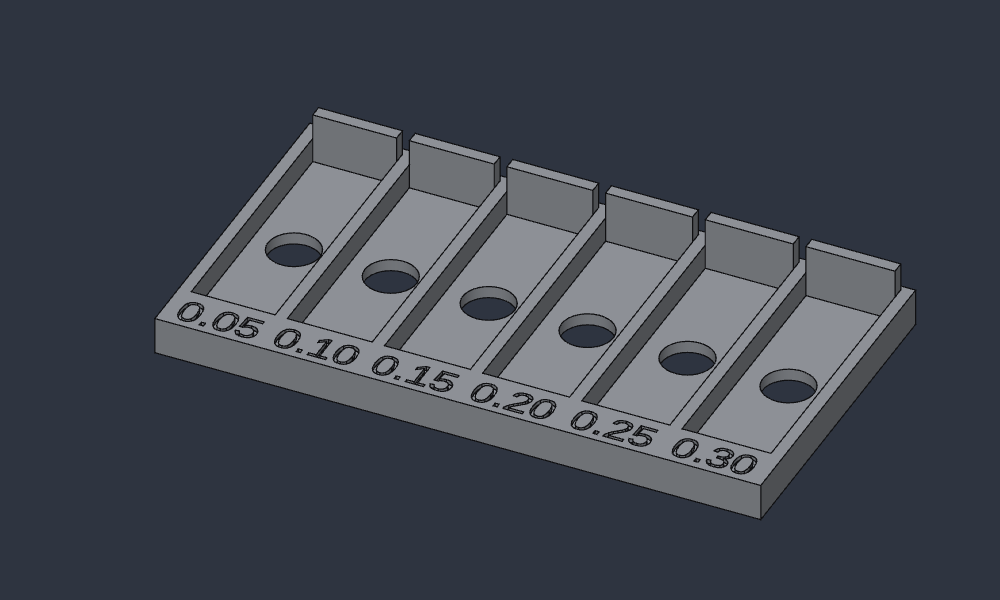

# Комплект для печати V1.0

Здесь собраны все STL проекта. `petg/` — жёсткие детали; `tpu/` — мягкие накладки. Предыдущие варианты CAD находятся в `../cad/archive/`, их STL сюда не смешаны.

## Что печатать

Количество указано для **двух установленных оснований (переднего и правого) и одного переносимого микрофона**.

| STL | Материал | Количество |
|---|---|---:|
| [Переднее основание](petg/clamp_base_m6.stl) | PETG | 1 |
| [Правое основание](petg/clamp_right_V1.stl) | PETG | 1 |
| [Магнитная стойка V1.0](petg/magnetic_stand_V1.stl) | PETG | 1 |
| [Внутренняя часть виброподвеса](petg/Fifine_Condenser_Shock_Mount_1.stl) | PETG | 1 |
| [Наружная часть виброподвеса](petg/Fifine_Condenser_Shock_Mount_2.stl) | PETG | 1 |
| [Основной вентиль](petg/hand_knob_m6.stl) | PETG | 2 |
| [Вентиль контргайки](petg/locknut_handwheel_m6.stl) | PETG | 2 |
| [Жёсткая пятка Ø24 мм](petg/pressure_pad_24mm.stl) | PETG | 2 |
| [Колпачок нижней пятки](tpu/tpu_grip_pad.stl) | Ultrafuse TPU 95A | 2 |
| [Верхняя накладка 18×33×1 мм](tpu/upper_tpu_pad.stl) | Ultrafuse TPU 95A | 2 |

Для одного основания выберите передний или правый вариант; обеих ручек и каждой накладки достаточно по одной.

## Печать

Рекомендации для **Prusa MK4, сопло 0,4 мм, слой 0,20 мм**. Жёсткие детали — **Prusament PETG Jet Black или Prusa Orange**; мягкие накладки — **Forward AM Ultrafuse TPU 95A Black**. Температуры, обдув, ретракты, поток и скорости берите из отлаженных профилей места печати.

Это стартовые настройки первого рабочего комплекта, а не результат испытаний напечатанных деталей.

### Периметры и заполнение

| Детали | Периметры | Заполнение | Сплошные слои сверху / снизу |
|---|---:|---|---:|
| Переднее и правое основания | **6** | **40% Gyroid** | **6 / 6** |
| Магнитная стойка | **6** | **35% Gyroid** | **6 / 6** |
| Внутренняя и наружная части виброподвеса | **4** | **30% Gyroid** | **5 / 5** |
| Основной вентиль, вентиль контргайки, жёсткая пятка | **5** | **100% Rectilinear** | **5 / 5** |
| TPU-колпачок нижней пятки и верхняя TPU-накладка | **3** | **100% Rectilinear** | **5 / 5** |

При слое 0,20 мм шесть сплошных слоёв дают оболочку толщиной 1,20 мм с каждой стороны, пять — 1,00 мм, если геометрия допускает такую толщину. Верхняя TPU-накладка имеет толщину всего 1 мм и печатается пятью слоями суммарно: настройки верхних и нижних оболочек не увеличивают толщину модели. Разреженное заполнение практически не позволит смягчить такую тонкую накладку.

На силовых деталях важнее сохранить периметры и правильную ориентацию, чем повышать заполнение до 100%. Шесть контуров при обычной ширине экструзии дают стенку примерно 2,5–2,8 мм; тонкие участки и раскосы будут преимущественно заполнены оболочками. Gyroid поддерживает деталь в разных направлениях и не имеет пересечений траекторий в одном слое, но не устраняет зависимость прочности от направления слоёв.

Ручки и пятка маленькие, а нагрузка возле шестигранных карманов и конца болта сосредоточенная — для них выбрано сплошное заполнение. Если требуется снизить стоимость крупных деталей, сначала сравните массу и время нарезки при 30% и 40% заполнения, сохраняя шесть периметров на основаниях и стойке. При цене PETG 0,8 Kč/г экономия на тонких стенках может оказаться небольшой.

### Ориентация на столе принтера

STL сохранены в координатах сборки: перед печатью разложите их в слайсере. Ориентация важнее разницы между 35% и 50% заполнения.

- **Основания:** на боковой плоскости, чтобы С-образный профиль лежал на столе принтера, в плоскости слоёв. Контуры должны непрерывно проходить через полки и спинку. Для правой версии отдельно проверьте поддержки под повёрнутым приёмником, раскосом и в направляющих.
- **Стойка:** широкой плоской спинкой вниз, карманами магнитов вверх. Длинная ось стойки лежит в плоскости стола. Отверстие шарнира получится горизонтальным — проверьте мосты и необходимость локальных поддержек.
- **Виброподвес:** обе части плашмя; внутренняя чашка открытой стороной вверх.
- **Ручки:** шестигранными карманами вверх. **Жёсткая пятка:** углублением вверх.
- **TPU-колпачок:** контактной рельефной поверхностью на столе, открытым бортиком вверх. **Верхняя TPU-накладка:** плашмя.

### Поддержки и проверка посадок

- Назначайте поддержки локально после просмотра нарезки. Особое внимание — посадкам магнитов, направляющим и отверстию шарнира. Не заполняйте поддержками все полости автоматически.
- Brim 3–5 мм добавляйте при небольшой площади контакта или склонности углов подниматься; всем деталям подряд он не нужен.
- Сначала напечатайте обе ручки, пятку и TPU-колпачок, затем проверьте посадки имеющегося крепежа. Карман магнита полезно проверить небольшим фрагментом модели до печати всего основания.
- При сборке затягивайте струбцину рукой до устойчивого удержания: дополнительный сильный прижим повышает длительную нагрузку на пластик.

Обоснование общих принципов: [Prusa — заполнение и роль периметров](https://help.prusa3d.com/article/infill_42), [виды заполнения](https://help.prusa3d.com/article/infill-patterns_177130). Конкретные значения в таблице выбраны для этого проекта.

## Тест посадки магнитов

Необязательная деталь перед печатью крепления: [magnet_fit_test.stl](petg/magnet_fit_test.stl), исходник — [magnet_fit_test.sc](../cad/magnet_fit_test.sc).

Шесть карманов под магниты **25×8×5 мм** расположены в один ряд, длинными сторонами поперёк полоски. Габарит 58,5×32×6,5 мм; основная часть высотой 3,7 мм. Дно и общие стенки толщиной 1,2 мм, стенки выступают над дном на 2,5 мм. Только один торцевой упор каждого кармана выше: его верх находится на отметке **1,2 + 5 + зазор** от стола печати. В дне каждого кармана сквозное отверстие Ø5 мм для выталкивания магнита отвёрткой с обратной стороны.

Подписи означают **зазор на одну сторону по длине и ширине**, а для высоты — прибавку один раз:

| Подпись, мм | Карман в плане, мм | Верх торцевого упора над дном кармана, мм |
|---:|---|---:|
| 0.05 | 25,10×8,10 | 5,05 |
| 0.10 | 25,20×8,20 | 5,10 |
| 0.15 | 25,30×8,30 | 5,15 |
| 0.20 | 25,40×8,40 | 5,20 |
| 0.25 | 25,50×8,50 | 5,25 |
| 0.30 | 25,60×8,60 | 5,30 |

Магнит лежит на дне и выступает над низкими стенками. Подберите карман по посадке в плане, а разницу высоты сравните с верхом высокого торцевого упора, например прямой линейкой и щупом. Упор служит открытой высотной базой; закрытого паза, проверяющего прохождение магнита по толщине, здесь нет. Попробуйте несколько купленных магнитов, чтобы учесть их фактические размеры.

Печатайте дном вниз, карманами и надписями вверх, без поддержек, тем же PETG и профилем филамента, что и крепление. Для этого тонкостенного теста достаточно 3 периметров, 20% Gyroid и 6 сплошных слоёв сверху/снизу при слое 0,20 мм: дно толщиной 1,2 мм и стенки фактически получатся сплошными. Объём модели около 3,75 см³ — примерно 4,8 г PETG при сплошной печати, без юбки/brim; окончательные расход и время смотрите в слайсере. Это примерно на 87% меньше материала первого двухрядного варианта.

**Высоты упоров идут с шагом 0,05 мм.** Обычный слой 0,20 мм округлит часть разных высот к одному уровню. Для отдельной проверки высоты задайте переменный слой 0,05 мм на участке Z=6,20…6,50 мм, сохранив обычный слой ниже; проверьте фактические верхние отметки в предварительном просмотре. Без такого уточнения тест пригоден для подбора зазоров в плане, но не различает все шесть высот. Результат боковой посадки относится к карманам, напечатанным отверстием вверх; другая ориентация в окончательной детали может изменить посадку.

[Пошаговая настройка PrusaSlicer: числовой диапазон высот, допустимый минимум слоя и проверка шести верхних отметок](../docs/prusaslicer-magnet-height-test.md).

## Покупные детали

[Проверенные товары Hornbach/Unimagnet, цены и рекомендации по шнуру — в BOM](../BOM.md). Крепёж шарнира наклона уже имеется и в покупки не входит.

Для комплекта из двух оснований:

- 2 полностью резьбовых болта М6×25 с шестигранной головкой под ключ 10 мм.
- 2 обычные гайки М6, высотой около 5 мм, в основания.
- 2 тонкие гайки М6 ISO 4035, высотой 3,2 мм, под ключ 10 мм, в вентили контргайки.
- 2 стальные увеличенные шайбы М6 DIN 9021 / ISO 7093: 6,4×18×1,6 мм.
- 6 магнитов 25×8×5 мм N52: по два на каждом основании и два на переносимой стойке.
- Упругий шнур для подвеса; крепёж его шарнира уже имеется.

[Выбранные магниты](https://www.unimagnet.cz/neodymovy-magnet-kvadr-25-8-5-mm-n52-sila-7-4-kg_z972/), [размеры тонкой гайки](https://www.ganternorm.com/en/products/3.2-Mounting-Positioning-Leveling-with-Retaining-Cables-Screws-Clamping-and-Supporting-Elements/Nuts/ISO-4035-Thin-Hex-Nuts-Stainless-Steel?artikelnr=4035-M6-035-NI), [таблица увеличенных шайб](https://www.aspenfasteners.com/content/pdf/Metric_DIN_9021_spec.pdf).

Стальные детали `*_reference`, микрофон и стол из CAD печатать не нужно.

## Сборка

1. Вклейте верхнюю TPU-накладку в карман под верхней полкой. Карман 18,4×33,4×0,8 мм, накладка выступает на 0,2 мм. Клей не наносится на стол.
2. Вставьте обычную гайку в карман сверху нижней полки.
3. Вставьте болт в основную ручку. Головка входит на 2,5 мм и выступает вниз примерно на 1,5 мм; над ней остаётся 2 мм пластика. При необходимости закрепите головку небольшим количеством клея.
4. Вставьте тонкую гайку в меньший вентиль. Карман глубиной 2,8 мм оставляет гайку выступающей на 0,4 мм. Не допускайте попадания клея на резьбу.
5. Навинтите вентиль контргайки на болт выступающей металлической стороной вверх, наденьте шайбу и вкрутите болт снизу в гайку основания.
6. Наденьте TPU-колпачок на жёсткую пятку и положите пятку углублением на конец винта. Пятка свободная — придерживайте её при снятии.
7. Установите основание на столешницу, создайте прижим основной ручкой, затем, удерживая её, слегка подтяните вентиль контргайки рукой. Перед снятием сначала отпустите контргайку.

Бортик вентиля центрирует шайбу, но не защёлкивает её: внутренний Ø18,6 мм, по 0,3 мм радиального зазора, верх на 0,8 мм ниже рабочей поверхности шайбы. TPU-колпачок имеет внутренний Ø23,6 мм под пятку Ø24 мм: предусмотрен натяг 0,2 мм на сторону. Оба соединения требуют проверки на печатных деталях.
